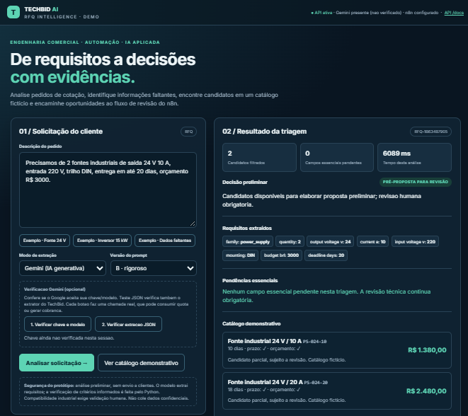
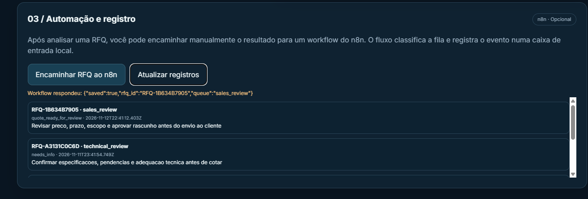
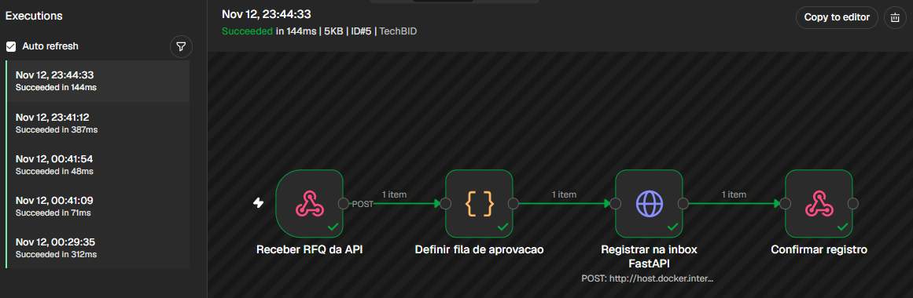

# TechBid AI

**AI-powered RFQ Intelligence & Technical Sales Automation**

From customer requirements to structured technical-commercial decisions, with Generative AI, deterministic validation, and automated review workflows.

**Python · FastAPI · Gemini · Pydantic · n8n · Prompt Engineering · Pytest**

## Overview

TechBid AI is an end-to-end prototype designed to automate the initial analysis of industrial Requests for Quotation (RFQs).

It combines Generative AI with engineering-oriented business rules to extract customer requirements, identify missing information, shortlist products from a demonstration catalog, and route requests to the appropriate review team.

## Key Features

- **AI-powered extraction:** Gemini converts natural-language RFQs into structured technical requirements.
- **Prompt engineering:** Two prompt strategies for comparing extraction behavior.
- **Baseline comparison:** A deterministic Python extractor provides a reference for evaluation.
- **Technical-commercial screening:** Python checks product attributes, quantities, budgets, and delivery constraints.
- **Automated workflow:** n8n routes requests to commercial or technical review.
- **FastAPI integration:** REST endpoints connect the application, automation workflow, and local inbox.
- **Evidence-based evaluation:** Labeled synthetic RFQs support reproducible comparisons.

## Application Demo

### 1. AI-powered RFQ Analysis

The application analyzes customer requests, extracts technical specifications, identifies missing information, and produces preliminary recommendations.



### 2. Automated Sales & Technical Review

After analysis, requests are routed according to their status.

Complete RFQs can enter the commercial review queue, while requests requiring clarification are directed to technical review.



### 3. n8n Workflow Execution

The workflow integrates four stages:

1. Receive the RFQ through a webhook.
2. Determine the appropriate review queue.
3. Register the request through FastAPI.
4. Confirm successful registration.



## How It Works

```text
Customer RFQ
     |
     v
Gemini / Python Baseline
     |
     v
Structured Requirements
     |
     v
Pydantic Validation
     |
     v
Python Catalog & Business Rules
     |
     v
Preliminary Decision
     |
     v
FastAPI Webhook
     |
     v
n8n Workflow
     |
     +----> Sales Review
     |
     +----> Technical Review
     |
     v
FastAPI Inbox & Confirmation
```

## Measured Results

A labeled dataset of five synthetic RFQs was used to compare deterministic Python extraction with Gemini using Prompt B.

| Metric | Python Baseline | Gemini — Prompt B |
|---|---:|---:|
| Correct present fields | 22/27 (81.5%) | **27/27 (100%)** |
| Correct product category | 4/5 | **5/5** |
| Fully correct extraction records | 3/5 | **5/5** |

These results come from a small, controlled demonstration dataset, not a production benchmark.

**Additional validation:**
- 34 automated Python tests passed in the packaged build.
- Successful end-to-end n8n executions were observed locally.
- Both commercial and technical review routing were demonstrated.
- Prompt evaluation identified differences in structured-output compliance.

## Technology Stack

| Technology | Application |
|---|---|
| **Python** | Core business logic and data processing |
| **FastAPI** | REST API and workflow integration |
| **Gemini API** | Generative AI requirement extraction |
| **Pydantic** | Structured data validation |
| **n8n** | Workflow automation and review routing |
| **Pytest** | Automated testing |
| **HTML / CSS / JavaScript** | Interactive web interface |

## Run Locally

### Windows

**1.** Clone the repository:

```powershell
git clone https://github.com/ioglas-af/techbid-ai.git
cd techbid-ai
```

**2.** Run the Windows launcher:

```powershell
.\INICIAR_WINDOWS.bat
```

**3.** Open the application:

http://127.0.0.1:8000

The Python baseline works without a Gemini API key.

To enable Gemini, configure your own API key in the local `.env` file, using `.env.example` as a reference.

### Run Tests

```powershell
.\.venv\Scripts\python.exe -m pytest -q
```

### n8n Integration

Import the workflow from:

`n8n/techbid_workflow.json`

Configure the local webhook and publish the workflow in n8n.

For detailed instructions, see [Guia rápido em português](docs/GUIA_RAPIDO_PT.md).

## Repository Structure

```text
techbid-ai/
├── assets/             # Application and workflow screenshots
├── techbid/            # API, extraction and business logic
├── static/             # Web interface
├── data/               # Synthetic RFQs and demonstration catalog
├── n8n/                # Workflow automation
├── evidence/           # Evaluation results
├── docs/               # Documentation
├── tests/              # Automated tests
├── INICIAR_WINDOWS.bat
├── requirements.txt
└── README.md
```

## Project Highlights

TechBid AI demonstrates the integration of:

- **Generative AI** into a technical-commercial workflow.
- **Prompt engineering and structured output validation** for industrial requirements.
- **Deterministic Python rules** alongside LLM-based extraction.
- **REST APIs and n8n automation** for end-to-end process execution.
- **Quantitative evaluation** using labeled demonstration cases.

The project illustrates how AI can support technical sales teams by reducing manual requirement extraction and organizing requests for human review.

All catalog products, prices, and customer requests used in the demonstration are fictional.

---

**Author:** Ioglas Alves da Fonseca  
Electrical Engineering · Technical Sales · Applied AI
